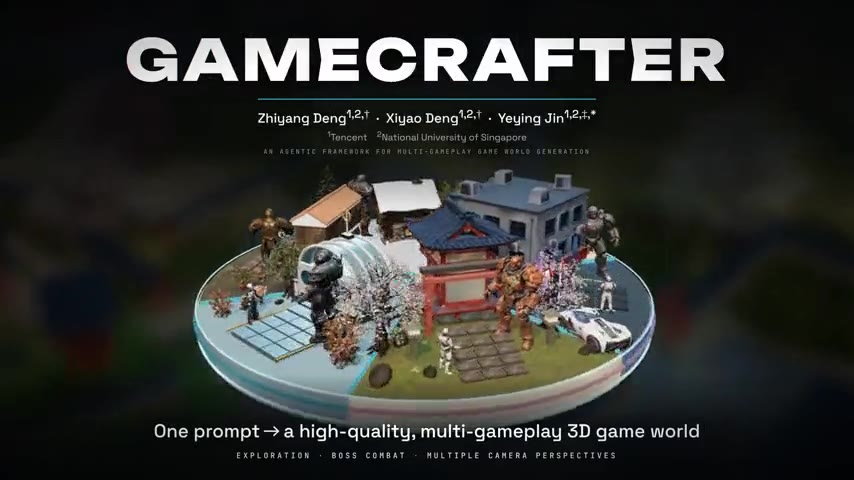
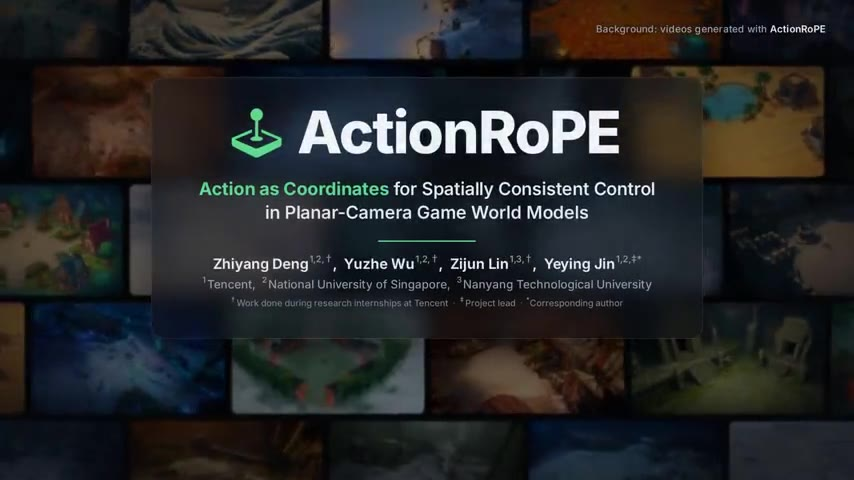
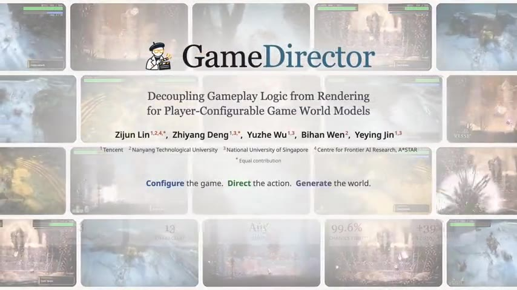
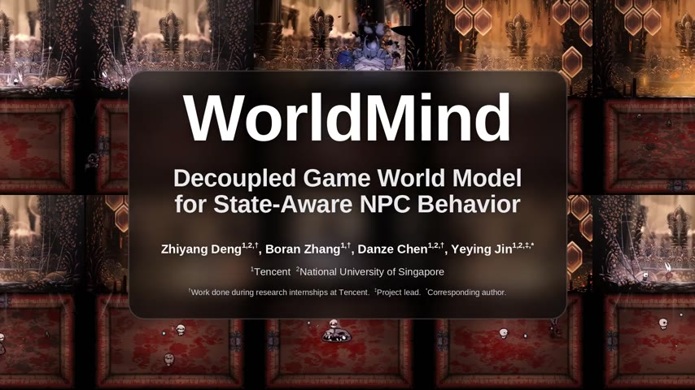

  

  
   
  

 

  
  &nbsp;
  
  &nbsp;
  
  &nbsp;
  

 

  
  &nbsp;
  

 

---

### 👋 About Me

I'm a **Master of Computing** student at the **National University of Singapore** and a **World Model Research Intern at Tencent**, supervised by [Dr. Yeying Jin](https://jinyeying.github.io/). In **January 2027** I'll join **Riot Games Singapore** as a full-time **Machine Learning Engineer and Researcher**.

I work on **image generation**, **video generation**, **world models**, and **3D generation** — lately, building generative game worlds: world models that follow game rules and player actions, and agents that turn one prompt into a playable 3D world.

📬 &nbsp;Open to research collaborations & discussions &nbsp;|&nbsp; 🌏 &nbsp;Based in Singapore

---

### 📌 News

- **2027.01** &nbsp;Joining **Riot Games Singapore** as a full-time Machine Learning Engineer and Researcher
- **2026.10** &nbsp;🚀 [GameDirector](https://jimntu.github.io/gamedirector/), [ActionRoPE](https://teawhite.cn/ActionRoPE/), and [GameCrafter](https://teawhite.cn/GameCrafter/) are released
- **2026.08** &nbsp;🚀 [WorldMind](https://teawhite.cn/WorldMind/) is released
- **2026.05** &nbsp;Started as a World Model Research Intern at **Tencent**

---

### 🔥 Recent Work

<table>
  <tr>
    <td width="50%" valign="top">
      
       
      <b>GameCrafter: An Agentic Framework for Multi-Gameplay Game World Generation</b>
       
      <b>Zhiyang Deng</b>*, Xiyao Deng*, Yeying Jin†
       
      One prompt → a high-quality, multi-gameplay 3D game world, with exploration, boss combat, three camera views, and aligned multimodal data.
        
      
      
      
    </td>
    <td width="50%" valign="top">
      
       
      <b>ActionRoPE: Action as Coordinates for Spatially Consistent Control in Planar-Camera Game World Models</b>
       
      <b>Zhiyang Deng</b>, Yuzhe Wu, Zijun Lin, Yeying Jin†
       
      Writes player actions into the positional encoding, so a top-down world model keeps places consistent when you walk away and come back.
        
      
      
      
      
    </td>
  </tr>
  <tr>
    <td width="50%" valign="top">
      
       
      <b>GameDirector: Decoupling Gameplay Logic from Rendering for Player-Configurable Game World Models</b>
       
      Zijun Lin*, <b>Zhiyang Deng</b>*, Yuzhe Wu, Bihan Wen, Yeying Jin†
       
      An agentic "director" enforces player-configured game rules while the world model renders the gameplay.
        
      
      
      
    </td>
    <td width="50%" valign="top">
      
       
      <b>WorldMind: Decoupled Game World Model for State-Aware NPC Behavior</b>
       
      <b>Zhiyang Deng</b>, Boran Zhang, Danze Chen, Yeying Jin†
       
      An LLM reads the game state and decides what the boss does next; the world model renders it in real time.
        
      
      
      
    </td>
  </tr>
</table>

* Equal contribution &nbsp;&nbsp; † Corresponding author

### 📄 Earlier Publications

 &nbsp;**HM-Avatar: Towards Realistic Loose Garment Modeling with Hierarchical MLPs**  
Hongyu Wang&#42;, <b>Zhiyang Deng</b>&#42;, Wenzhe He, Xiaojun Chen, Ying Liu, Ruihui Li† &nbsp;·&nbsp; <a href="https://ieeexplore.ieee.org/abstract/document/11462401">paper</a>

 &nbsp;**Grid-A-Character: Delving into Grid Condition Strategy for Unlocking Consistent and Controllable Character Generation**  
<b>Zhiyang Deng</b>&#42;, Zhuofan Xiao&#42;, Jian Yang, Zhenyu Zhang†

 &nbsp;**TextureAvatar: Texture-Enhanced 3D Gaussian Splatting for Avatar Modeling from Monocular Videos**  
<b>Zhiyang Deng</b>, Hongyu Wang, Xiaojun Chen, Ying Liu, Ruihui Li†

---

### 🔬 Research Interests

<table>
  <tr>
    <td align="center" width="25%">
      <h4>🖼️ Image Generation</h4>
      
      
    </td>
    <td align="center" width="25%">
      <h4>🎬 Video Generation</h4>
      
      
    </td>
    <td align="center" width="25%">
      <h4>🌍 World Models</h4>
      
      
    </td>
    <td align="center" width="25%">
      <h4>🧊 3D Generation</h4>
      
      
    </td>
  </tr>
</table>

---

### 💼 Experience

<table>
  <tr>
    <td>🎮</td>
    <td><b>Machine Learning Engineer & Researcher</b> &nbsp;</td>
    <td><b>Riot Games</b></td>
    <td><i>From Jan 2027</i></td>
  </tr>
  <tr>
    <td>🌍</td>
    <td><b>World Model Research Intern</b></td>
    <td><b>Tencent</b></td>
    <td><i>May 2026 – Present</i></td>
  </tr>
  <tr>
    <td>🎮</td>
    <td><b>Generative AI Research Intern</b></td>
    <td><b>Riot Games</b></td>
    <td><i>Jan 2026 – May 2026</i></td>
  </tr>
  <tr>
    <td>🔬</td>
    <td><b>Research Assistant</b></td>
    <td><b>Nanjing University (Suzhou)</b></td>
    <td><i>Nov 2024 – Dec 2025</i></td>
  </tr>
  <tr>
    <td>🔬</td>
    <td><b>Research Intern</b></td>
    <td><b>The Hong Kong Polytechnic University</b></td>
    <td><i>Oct 2024 – Apr 2025</i></td>
  </tr>
</table>

### 🎓 Education

<table>
  <tr>
    <td>🏫</td>
    <td><b>Master of Computing</b></td>
    <td><b>National University of Singapore</b></td>
    <td><i>Aug 2025 – Jan 2027</i></td>
  </tr>
  <tr>
    <td>🏫</td>
    <td><b>B.Sc. Mathematics & Applied Mathematics</b></td>
    <td><b>Hunan University</b></td>
    <td><i>Sep 2021 – Jun 2025</i></td>
  </tr>
</table>

---

### 📊 GitHub Activity

  

---

### 🏆 Honors

| Year | Award |
|------|-------|
| 🥇 2024 | Individual Scholarship — Hunan University |
| 🥇 2023 | Individual Scholarship — Hunan University |
| 🥇 2022 | Individual Scholarship — Hunan University |

---

  

